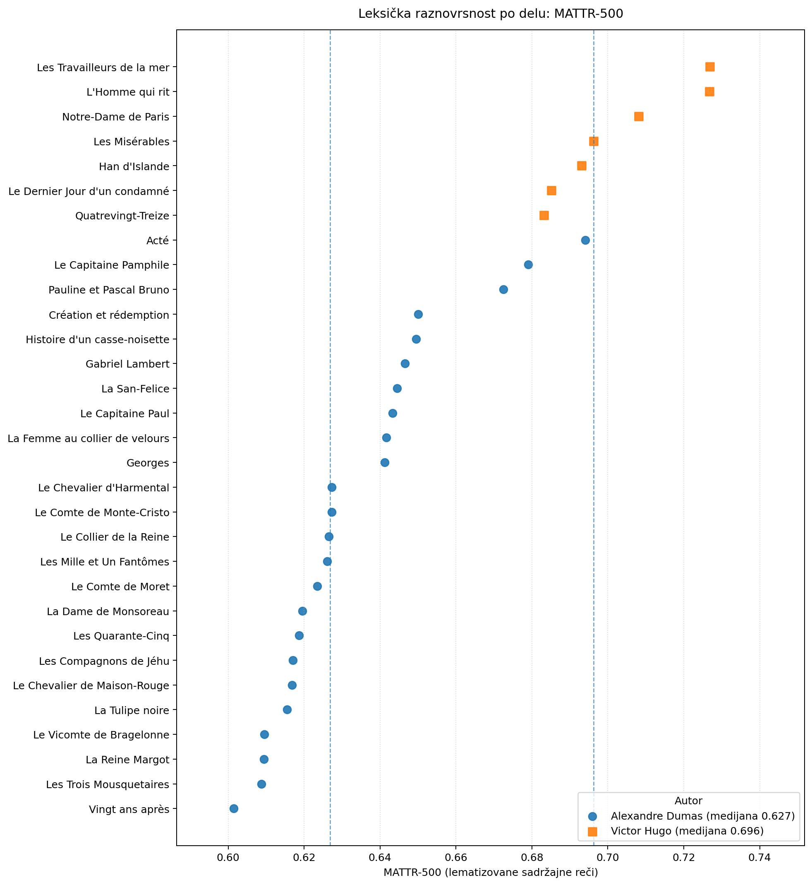

# Analyse computationnelle du lexique et du style : Alexandre Dumas père et Victor Hugo

## Présentation du projet

Ce projet explore les possibilités de l'analyse computationnelle pour étudier les caractéristiques lexicales et stylistiques des œuvres de fiction en prose d'**Alexandre Dumas père** et de **Victor Hugo**.

À l'aide de Python et de méthodes de traitement automatique du langage naturel (TALN), le projet vise à constituer un corpus littéraire numérique documenté et reproductible, à analyser les propriétés linguistiques des textes et à examiner les ressemblances et les différences entre les deux auteurs.

Le projet se situe à l'intersection de la **science des données, du traitement automatique des langues et des humanités numériques**.

**État du projet :** périmètre du corpus v1.0 fixé ; 54 volumes regroupés en 31 unités d'analyse ; lemmatisation et premières analyses descriptives réalisées. La validation bibliographique et qualitative exhaustive du corpus, ainsi que l'interprétation approfondie des résultats, restent à poursuivre.

Le corpus comprend 24 œuvres d'Alexandre Dumas père et 7 de Victor Hugo. Les textes complets et les fichiers de tokens générés sont conservés localement et ne sont pas distribués dans le dépôt.

## Objectifs de recherche

Les objectifs du projet sont les suivants :

- Constituer un corpus numérique de textes littéraires français attribués à Alexandre Dumas père et à Victor Hugo.
- Automatiser le téléchargement, le nettoyage et le regroupement des textes.
- Documenter les décisions de sélection et assurer la traçabilité des sources.
- Étudier les fréquences lexicales et la distribution des lemmes.
- Mesurer la diversité lexicale à l'aide de plusieurs indicateurs, notamment le *Type-Token Ratio* (TTR) et le *Moving-Average Type-Token Ratio* (MATTR).
- Comparer les distributions lexicales entre les œuvres et les auteurs.
- Explorer les apports de la pondération TF-IDF et d'autres méthodes quantitatives.
- Produire des visualisations permettant d'examiner les résultats à l'échelle des œuvres.
- Interpréter les résultats en tenant compte de la longueur des textes, des différences de genre et des limites du corpus.

Le projet ne présuppose pas que les deux auteurs possèdent des styles homogènes ou systématiquement opposés. Les analyses ont pour objectif de dégager des tendances descriptives et de formuler des hypothèses susceptibles d'être examinées plus avant.

## Corpus

### Sources et périmètre

Le corpus est constitué à partir de textes disponibles dans le catalogue de [Project Gutenberg](https://www.gutenberg.org/).

Les deux auteurs étudiés sont :

- **Alexandre Dumas père** (1802–1870)
- **Victor Hugo** (1802–1885)

Le corpus de travail v1.0 comprend :

| Indicateur | Valeur |
|---|---:|
| Volumes sources | 54 |
| Unités d'analyse | 31 |
| Œuvres de Dumas | 24 |
| Œuvres de Hugo | 7 |

Les volumes appartenant à une même œuvre sont regroupés en une seule unité d'analyse, dans l'ordre défini par le manifeste. Les fichiers sources et la correspondance entre les volumes et les unités d'analyse sont conservés pour assurer la traçabilité.

Les critères de sélection privilégient les romans et les textes de fiction en prose. Les textes non fictionnels, la poésie, le théâtre et les œuvres d'autres auteurs sont exclus du périmètre prévu. Les œuvres simplement traduites ou éditées par Dumas ne sont pas assimilées automatiquement à des œuvres de sa création.

### Documentation du corpus

Les principaux fichiers de documentation sont :

- `corpus_manifest_v1_locked.csv` : manifeste définissant le périmètre du corpus.
- `corpus_source_volume_map_v1.csv` : correspondance entre les volumes sources et les unités d'analyse.
- `CORPUS_FREEZE_v1.md` : documentation du gel du périmètre du corpus.

Ces fichiers permettent de retracer les décisions de sélection et les regroupements effectués.

Le périmètre v1.0 est fixé pour assurer la stabilité des analyses en cours. Ce gel ne signifie pas que la validation bibliographique et qualitative de chaque texte est achevée.

## Méthodologie

### 1. Identification et téléchargement des textes

Les textes sont identifiés à partir du catalogue de Project Gutenberg. Un manifeste documente les entrées retenues et les décisions de sélection.

Le téléchargement automatisé permet de récupérer les textes approuvés sans modifier le périmètre défini par le manifeste.

### 2. Audit, nettoyage et regroupement

Des scripts contrôlent la présence des fichiers attendus, les marqueurs de début et de fin de Project Gutenberg et certains problèmes structurels.

Les textes sont ensuite nettoyés et les volumes appartenant à une même œuvre sont regroupés dans l'ordre prévu par le manifeste.

Les rapports de contrôle et de construction du corpus permettent de documenter ces opérations. Toutefois, les contrôles automatiques ne garantissent pas l'élimination de tous les éléments éditoriaux résiduels. Une validation qualitative complémentaire reste nécessaire.

### 3. Lemmatisation et annotation linguistique

La lemmatisation est réalisée avec **spaCy** et le modèle français `fr_core_news_lg`.

Le pipeline produit des fichiers de tokens compressés au format TSV, avec des informations linguistiques telles que :

- la forme du token et sa forme lemmatisée ;
- la catégorie grammaticale et les informations morphologiques ;
- l'identification des mots alphabétiques, des mots-outils et de la ponctuation ;
- les indices de phrases et les dépendances syntaxiques ;
- les entités nommées et leurs catégories.

Les composants du pipeline spaCy sont conservés, notamment le parseur syntaxique et le composant de reconnaissance d'entités nommées.

Les résultats de la reconnaissance automatique des entités doivent être interprétés avec prudence. Les noms de personnes peuvent être manqués ou mal classés ; les annotations ne constituent donc pas une validation manuelle exhaustive des personnages.

La méthode, les paramètres et le format des données sont documentés dans `LEMMATIZATION.md`.

### 4. Analyse lexicale et comparative

L'analyse exploite les fichiers de tokens lemmatisés afin de produire des statistiques par œuvre et par auteur.

Les analyses actuellement mises en œuvre comprennent notamment :

- les fréquences absolues des lemmes ;
- les fréquences relatives pour 10 000 tokens ;
- les distributions lexicales par œuvre et par auteur ;
- le nombre de tokens et de lemmes distincts ;
- le *Type-Token Ratio* (TTR) ;
- le *Moving-Average Type-Token Ratio* (MATTR) ;
- des comparaisons complémentaires après exclusion des mots-outils et, dans une analyse spécifique, des tokens reconnus comme des noms de personnes.

Le TTR est calculé comme le rapport entre le nombre de types distincts et le nombre total de tokens dans l'ensemble considéré. Cette mesure est fortement sensible à la longueur du texte : elle tend à diminuer lorsque le nombre de tokens augmente.

Le MATTR atténue ce problème en calculant le TTR sur des fenêtres glissantes de taille fixe, puis en faisant la moyenne des résultats obtenus.

Pour la comparaison principale présentée dans ce dépôt, le MATTR est calculé sur des fenêtres de 500 lemmes de mots lexicaux. Une fenêtre de 1 000 tokens est également utilisée pour examiner la sensibilité des résultats au choix de la taille de fenêtre.

L'exclusion des mots-outils et l'exclusion supplémentaire des entités reconnues comme des personnes correspondent à des ensembles d'analyse distincts. Ces choix de filtrage influencent les valeurs obtenues et doivent être pris en compte lors de leur interprétation.

## Résultats exploratoires

### Diversité lexicale : MATTR-500

Le graphique suivant compare la diversité lexicale des 31 unités d'analyse du corpus, à l'aide du *Moving-Average Type-Token Ratio* calculé sur des fenêtres de 500 lemmes de mots lexicaux.



Chaque point représente une œuvre. Les lignes verticales en pointillés indiquent la médiane du MATTR pour chaque auteur.

Dans la version actuelle du corpus, les valeurs de MATTR-500 sont généralement plus élevées pour les œuvres de Hugo que pour celles de Dumas. Cette observation constitue un résultat descriptif portant sur les œuvres incluses dans le corpus ; elle ne démontre pas, à elle seule, une différence générale de richesse lexicale entre les deux auteurs.

L'interprétation doit tenir compte du nombre inégal d'œuvres, des genres, des sujets, de la structure narrative et des choix de prétraitement. La reconnaissance des noms de personnes et les autres opérations de filtrage peuvent également influencer les résultats.

Les résultats quantitatifs doivent être considérés comme exploratoires tant que la validation qualitative du corpus et les analyses complémentaires ne sont pas achevées.

### Rapports de résultats

Les tableaux générés par le script d'analyse sont enregistrés dans le répertoire `reports/`. Ils comprennent notamment :

- `work_statistics.csv` : statistiques descriptives par œuvre ;
- `top_lemmas_by_work.csv` : principaux lemmes par œuvre et par ensemble d'analyse ;
- `lemma_frequencies_by_work.csv` : fréquences lexicales par œuvre ;
- `lemma_frequencies_by_author.csv` : fréquences lexicales agrégées par auteur ;
- `author_lemma_comparison.csv` : tableau comparatif des fréquences lexicales entre auteurs.

Les fichiers sont générés à partir des données locales de lemmatisation. Ils ne remplacent pas l'examen des textes et ne doivent pas être interprétés comme des preuves statistiques définitives.

## Technologies

Les principaux outils utilisés sont :

- **Python** — automatisation, traitement et analyse des données ;
- **spaCy** — tokenisation, lemmatisation, analyse morphosyntaxique et reconnaissance d'entités nommées ;
- **pandas** — manipulation des tableaux et des métadonnées ;
- **Matplotlib** — visualisation des résultats ;
- **scikit-learn** — outils de vectorisation et analyses TF-IDF prévues dans le projet.

Les versions effectivement utilisées et les paramètres du traitement linguistique sont documentés dans les fichiers méthodologiques correspondants.

## Structure du projet

La structure du dépôt public est organisée autour des scripts, des manifestes et de la documentation. Les données volumineuses générées localement ne sont pas destinées à être publiées par défaut.

```text
Dumas-Hugo-comparaison/
├── README.md
├── .gitignore
├── requirements.txt
├── gutenberg_corpus.py
├── download_approved_texts.py
├── audit_raw_corpus.py
├── clean_corpus.py
├── join_volumes.py
├── lemmatize_corpus.py
├── analyze_corpus.py
├── LEMMATIZATION.md
├── CORPUS_FREEZE_v1.md
├── corpus_manifest_v1_locked.csv
├── corpus_source_volume_map_v1.csv
├── reports/
│   ├── work_statistics.csv
│   ├── top_lemmas_by_work.csv
│   ├── lemma_frequencies_by_work.csv
│   ├── lemma_frequencies_by_author.csv
│   ├── author_lemma_comparison.csv
│   └── figures/
│       └── mattr_content_500_by_work.png
├── notebooks/
└── data/
    ├── raw/
    ├── cleaned/
    ├── works/
    └── lemmas/
```

Cette arborescence décrit l'organisation logique du projet. Certains fichiers de données et rapports peuvent rester uniquement en local, selon leur taille et leur utilité pour la reproductibilité.

Les répertoires `data/raw/`, `data/cleaned/`, `data/works/` et `data/lemmas/` contiennent des données générées ou téléchargées localement. Les textes complets et les fichiers de tokens lemmatisés ne sont pas inclus dans le dépôt public.

Les rapports CSV de petite taille et les figures sélectionnées peuvent être publiés lorsqu'ils sont utiles à la vérification des résultats et ne contiennent pas de données qui doivent rester locales.

## Reproductibilité

### Prérequis

- Python 3.10 ou version ultérieure.
- Une connexion Internet pour télécharger les textes depuis Project Gutenberg.
- Les dépendances Python indiquées dans `requirements.txt`.
- Le modèle spaCy français `fr_core_news_lg` pour la lemmatisation.

Les versions des bibliothèques et du modèle peuvent influencer les annotations linguistiques et les résultats. Pour reproduire les analyses, il convient d'utiliser l'environnement documenté dans les fichiers de dépendances et de méthodologie.

### Installation

Cloner le dépôt et accéder au répertoire du projet :

```bash
git clone https://github.com/buka-buka-glasnost/Dumas-Hugo-comparaison.git
cd Dumas-Hugo-comparaison
```

Installer les dépendances :

```bash
python -m pip install -r requirements.txt
```

Si le modèle spaCy français n'est pas déjà installé dans l'environnement :

```bash
python -m spacy download fr_core_news_lg
```

### Exécution du pipeline de construction du corpus

Les étapes suivantes concernent la construction du corpus. Elles sont présentées dans leur ordre logique.

**1. Télécharger les textes approuvés**

```bash
python download_approved_texts.py
```

Le script utilise les entrées approuvées dans le manifeste. Le nombre de téléchargements peut être limité par exécution ; si nécessaire, relancer la commande jusqu'à ce que les fichiers attendus soient présents.

**2. Auditer les fichiers téléchargés**

```bash
python audit_raw_corpus.py
```

Consulter le rapport d'audit pour vérifier les fichiers manquants, les doublons et les problèmes structurels détectés.

**3. Nettoyer les textes**

```bash
python clean_corpus.py
```

Les textes nettoyés sont enregistrés dans le répertoire prévu par le script. Les fichiers sources restent séparés afin de préserver la traçabilité.

**4. Regrouper les volumes**

```bash
python join_volumes.py
```

Les volumes d'une même œuvre sont regroupés en unités d'analyse selon le manifeste. Consulter les rapports de construction et de correspondance des volumes pour vérifier les regroupements.

Ces étapes ne doivent être réexécutées que si une reconstruction du corpus est nécessaire. Le périmètre v1.0 est documenté dans les fichiers de gel du corpus.

### Exécution de la lemmatisation

Après avoir vérifié que les textes regroupés sont présents dans `data/works/`, exécuter :

```bash
python lemmatize_corpus.py
```

Le script lit les textes du corpus local et produit les fichiers de tokens compressés ainsi qu'un rapport de lemmatisation dans le répertoire prévu.

Les fichiers générés sont volumineux et restent exclus du dépôt public.

Pour les détails relatifs aux colonnes produites, aux paramètres et aux limites du traitement, consulter `LEMMATIZATION.md`.

### Exécution de l'analyse

Une fois les fichiers lemmatisés disponibles, lancer :

```bash
python analyze_corpus.py
```

Le script produit les tableaux de statistiques et de fréquences décrits dans la section « Rapports de résultats ». Il exploite les données locales et ne nécessite pas de télécharger à nouveau les textes ni de relancer la lemmatisation lorsque les fichiers générés sont déjà disponibles.

Les chemins et les noms des colonnes du manifeste doivent correspondre à ceux attendus par le script d'analyse.

## Limites méthodologiques

Plusieurs limites doivent être prises en compte :

- **Représentativité du corpus :** les 31 unités d'analyse ne représentent pas nécessairement l'ensemble de la production littéraire des deux auteurs.
- **Déséquilibre entre auteurs :** Dumas est représenté par 24 œuvres et Hugo par 7. Les résultats agrégés ne doivent pas être interprétés sans tenir compte de cette différence.
- **Genres et sujets :** les thèmes, les genres, les personnages et les choix narratifs peuvent influencer les fréquences lexicales et les mesures de diversité.
- **Longueur des textes :** le TTR brut est sensible à la longueur. Le MATTR atténue ce problème sans éliminer toutes les différences liées à la composition du corpus.
- **Prétraitement :** les décisions de nettoyage, de tokenisation, de lemmatisation et de filtrage peuvent modifier les résultats.
- **Reconnaissance d'entités :** les noms de personnes détectés automatiquement ne sont pas exhaustifs et peuvent contenir des erreurs.
- **Validation bibliographique :** les contrôles automatisés ne remplacent pas une vérification qualitative des textes et des éditions.
- **Interprétation statistique :** les différences descriptives ne suffisent pas à établir des différences stylistiques générales ou des relations causales.

Ces limites doivent guider les analyses complémentaires et la formulation des conclusions.

## Feuille de route

- [x] Identification initiale des textes dans le catalogue de Project Gutenberg.
- [x] Constitution et documentation du manifeste de travail.
- [x] Téléchargement des 54 volumes sélectionnés.
- [x] Contrôles structurels automatisés des fichiers.
- [x] Nettoyage automatique des textes.
- [x] Regroupement en 31 unités d'analyse.
- [x] Gel du périmètre du corpus v1.0.
- [x] Lemmatisation des textes avec spaCy.
- [x] Documentation de la méthode de lemmatisation.
- [x] Calcul des statistiques descriptives et des fréquences lexicales.
- [x] Calcul des mesures TTR et MATTR.
- [x] Première visualisation comparative du MATTR-500.
- [ ] Validation bibliographique et qualitative exhaustive du corpus.
- [ ] Vérification qualitative des résidus éditoriaux sur des extraits représentatifs.
- [ ] Validation manuelle d'un échantillon des entités nommées.
- [ ] Analyses complémentaires de robustesse et interprétation approfondie.
- [ ] Documentation complète de l'environnement de calcul et des versions.
- [ ] Finalisation de la présentation des résultats et des conclusions.

## Sources

Les textes du corpus ont été identifiés à partir du catalogue de [Project Gutenberg](https://www.gutenberg.org/).

Les références bibliographiques et les identifiants des éditions retenues sont documentés dans les manifestes du corpus. Les conditions de redistribution des textes doivent être vérifiées séparément de celles applicables au code du projet.

## Licence et droits d'auteur

Le code du projet peut être distribué sous une licence libre définie séparément.

Les droits applicables aux œuvres, aux éditions numériques et aux fichiers téléchargés doivent être examinés indépendamment, notamment en fonction de la juridiction concernée et des conditions de distribution.

La présence d'un texte sur Project Gutenberg ne signifie pas nécessairement que sa redistribution est autorisée dans toutes les juridictions. Pour cette raison, les textes complets et les fichiers de tokens lemmatisés ne sont pas distribués dans ce dépôt.

---

*Projet de recherche en humanités numériques consacré à l'analyse computationnelle de la littérature française.*
